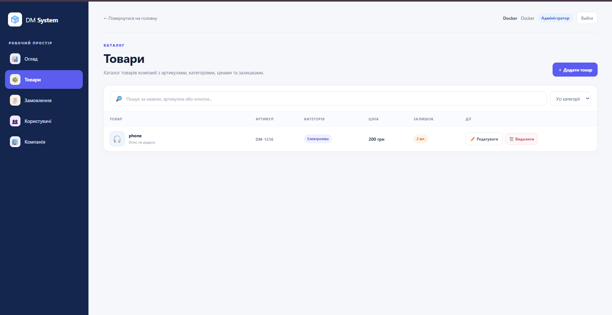

# USER GUIDE — DM-System

## 1. Вступ

### 1.1. Призначення документа

Цей документ містить інструкцію користувача програмної системи DM-System. У ньому описано призначення системи, умови її використання, порядок підготовки до роботи, основні можливості та дії користувача в разі виникнення помилок.

DM-System — це багатоплатформна програмна система для роботи з даними компанії, товарами та замовленнями. Проєкт передбачає використання вебверсії, настільного застосунку й мобільного застосунку.

Система складається з таких основних компонентів:

- **Web** — вебінтерфейс на основі React.
- **Desktop** — настільна версія на основі Electron.
- **Mobile** — мобільний застосунок на основі Expo та React Native.
- **Backend** — серверна частина на Apollo Server і GraphQL.
- **Database** — MongoDB для зберігання даних.

Документ призначений для користувачів, які мають базові навички роботи з комп’ютером і вебзастосунками. Для запуску проєкту з вихідного коду необхідні базові знання роботи з командним рядком.

Для кращого розуміння системи також можна ознайомитися з документацією проєкту, що описує його архітектуру, структуру бази даних та інтерфейс користувача.

### 1.2. Призначення та умови застосування

DM-System призначений для роботи з інформацією про товари та замовлення в межах системи управління діяльністю компанії.

Програмна система передбачає використання на таких платформах:

- персональні комп’ютери через веббраузер;
- настільні комп’ютери через Electron-застосунок;
- мобільні пристрої через застосунок на Expo / React Native.

**Системні вимоги**

Для роботи з проєктом потрібні:

- операційна система Windows, macOS або Linux для розробки;
- сучасний веббраузер для доступу до вебінтерфейсу;
- Node.js та npm для встановлення залежностей і запуску компонентів;
- MongoDB для зберігання даних;
- мережеве з’єднання для взаємодії клієнтських компонентів із серверною частиною;
- Expo Go або відповідне середовище запуску для перевірки мобільної версії.

**Технологічна основа системи**

- React 19 — вебінтерфейс;
- Electron — настільний застосунок;
- Expo SDK 58 та React Native 0.88 — мобільний застосунок;
- Apollo Server 5 та GraphQL 16 — серверна частина;
- Mongoose 8 — взаємодія з MongoDB.

Для повноцінної роботи системи необхідно забезпечити доступність серверної частини та коректне підключення до бази даних.

### 1.3. Підготовка до роботи

Для запуску системи з вихідного коду необхідно виконати такі дії.

**Крок 1. Отримання проєкту**

Клонувати репозиторій:

```bash
git clone <URL-репозиторію>
```

Перейти до кореневої папки проєкту:

```bash
cd DM-System
```

**Крок 2. Встановлення залежностей**

У кореневій папці проєкту виконати:

```bash
npm install
```

Ця команда встановлює залежності кореневого проєкту та його налаштованих npm Workspaces.

Оскільки серверна та мобільна частини розміщені в окремих папках, для них необхідно встановити залежності окремо:

```bash
npm install --prefix server-graphql
```

```bash
npm install --prefix mobile
```

**Крок 3. Налаштування конфігурації**

Перед запуском потрібно перевірити наявність конфігураційних файлів `.env` для відповідних компонентів.

У серверній частині необхідно налаштувати параметри підключення до MongoDB та секретний ключ JWT. Для цього використовуються змінні середовища, які зчитуються за допомогою пакета dotenv.

У клієнтських компонентах потрібно перевірити адресу GraphQL API. Для цього можуть використовуватися такі змінні середовища:

- `VITE_GRAPHQL_URL` — адреса GraphQL API для вебверсії;
- `EXPO_PUBLIC_GRAPHQL_URL` — адреса GraphQL API для мобільної версії.

Точні назви та розташування змінних потрібно звірити з конфігураційними файлами відповідних компонентів.

Значення змінних необхідно брати з наявних шаблонів `.env.example` або фактичної конфігурації проєкту. Секретні значення не слід передавати стороннім особам або розміщувати у відкритому репозиторії.

**Крок 4. Запуск серверної частини**

Серверна частина розміщена в папці `server-graphql`. Для її запуску з кореневої папки проєкту використовується команда:

```bash
npm run start:api
```

Ця команда запускає сервер через npm-скрипт `dev`, який виконує:

```bash
node --watch index.js
```

Серверна частина використовує Apollo Server для обробки GraphQL-запитів, Mongoose для взаємодії з MongoDB, JWT для автентифікації та bcryptjs для хешування паролів.

Після успішного запуску сервер має повідомити про готовність до роботи та підключення до бази даних MongoDB.

**Крок 5. Запуск вебверсії**

Для запуску вебінтерфейсу виконати:

```bash
npm run start:web
```

Команда запускає Vite для workspace `dm-system-web`.

Після запуску в терміналі відображається локальна адреса сервера. Її необхідно відкрити у веббраузері.

**Крок 6. Запуск настільної версії**

Для запуску Desktop-версії виконати:

```bash
npm run start:desktop
```

Ця команда одночасно запускає вебсервер Vite та настільний застосунок Electron. Для цього використовуються пакети `concurrently` і `wait-on`.

Після запуску Vite та готовності локального сервера відкривається окреме вікно Electron із інтерфейсом DM-System.

**Крок 7. Запуск мобільної версії**

Мобільний застосунок розміщений у папці `mobile` та побудований із використанням Expo і React Native.

Для запуску середовища розробки з кореневої папки проєкту використовується:

```bash
npm run start:mobile
```

Команда запускає Expo у папці `mobile`.

Після запуску в терміналі відображається інтерфейс розробки з QR-кодом. Його можна використати для відкриття застосунку на мобільному пристрої за допомогою Expo Go, якщо конфігурація та сумісність пристрою це підтримують.

Для запуску мобільного застосунку на окремих платформах передбачені команди, які виконуються з папки `mobile`:

```bash
npm run android
npm run ios
npm run web
```

Вони запускають Expo відповідно для Android, iOS та Web.

**Додаткові команди**

Для створення production-збірки вебверсії використовується:

```bash
npm run build:web
```

Для запуску тестів компонентів, у яких вони налаштовані, використовується:

```bash
npm test
```

Окремі команди запуску тестів:

```bash
npm run test:core
npm run test:web
npm run test:desktop
```

### 1.4. Опис функціональних можливостей програмної системи

DM-System передбачає взаємодію користувача із системою через вебінтерфейс, настільний застосунок та мобільний застосунок.

Основні функціональні напрями системи пов’язані з автентифікацією користувачів, роботою з товарами та замовленнями, а також обміном даними між клієнтськими компонентами й серверною частиною.

#### 1.4.1. Реєстрація та авторизація

Система використовує серверну частину для обробки запитів, пов’язаних з обліковими записами користувачів.

Під час реєстрації користувач вводить необхідні дані у відповідні поля та надсилає форму. Сервер обробляє отриманий запит і повертає результат операції.

Для входу користувач вводить свої облікові дані та підтверджує форму. Для автентифікації використовується механізм JWT. Паролі обробляються із застосуванням bcryptjs.

**Рисунок 1 — Екран реєстрації та авторизації користувача.**


#### 1.4.2. Основний інтерфейс системи

Після відкриття вебверсії або настільного застосунку користувач переходить до інтерфейсу DM-System.

Інтерфейс призначений для доступу до основних розділів системи та взаємодії з її даними.

Користувач може переходити між доступними розділами за допомогою елементів навігації.

**Рисунок 2 — Основний інтерфейс DM-System.**


#### 1.4.3. Робота з товарами

Одним із напрямів використання системи є робота з інформацією про товари.

Користувач взаємодіє з відповідним розділом інтерфейсу для перегляду та керування товарними даними.

Інформація передається до серверної частини за допомогою GraphQL-запитів та обробляється відповідно до реалізованої логіки системи.

**Рисунок 3 — Інтерфейс роботи з товарами.**


#### 1.4.4. Робота із замовленнями

Система передбачає роботу з інформацією про замовлення.

Користувач переходить до відповідного розділу інтерфейсу, де може переглядати доступні записи та інформацію про замовлення.

Обробка даних здійснюється серверною частиною, а результати запитів відображаються у клієнтському інтерфейсі.

**Рисунок 4 — Інтерфейс роботи із замовленнями.**

#### 1.4.5. Використання настільної версії

Настільна версія DM-System реалізована з використанням Electron.

Вона забезпечує запуск інтерфейсу системи в окремому вікні комп’ютерного застосунку. Для взаємодії з функціями системи користувач використовує елементи інтерфейсу, аналогічні вебверсії.

**Рисунок 5 — Вікно настільного застосунку DM-System.**


#### 1.4.6. Використання мобільної версії

Мобільна версія DM-System розробляється з використанням Expo та React Native.

Вона призначена для використання системи на мобільних пристроях. Для взаємодії користувач використовує елементи мобільного інтерфейсу.

У мобільному компоненті передбачено використання `expo-secure-store` для роботи із захищеним локальним сховищем.

**Рисунок 6 — Інтерфейс мобільної версії DM-System.**


### 1.5. Аварійні ситуації

Під час роботи з DM-System можуть виникати ситуації, пов’язані з некоректним введенням даних, проблемами мережевого з’єднання, помилками авторизації або недоступністю серверної частини.

**Некоректне введення даних**

Якщо користувач вводить некоректні або неповні дані, необхідно перевірити заповнені поля та повторити операцію. Якщо система відображає повідомлення про помилку, слід врахувати його зміст і виправити введені значення.

**Помилка авторизації**

Якщо вхід не виконується, потрібно перевірити правильність введених облікових даних. Також необхідно переконатися, що серверна частина доступна та запити обробляються належним чином.

**Втрата мережевого з’єднання**

У разі втрати мережевого з’єднання взаємодія із серверною частиною може стати недоступною. Потрібно перевірити підключення до мережі та повторити запит після відновлення з’єднання.

**Недоступність сервера**

Якщо серверна частина не запущена або не відповідає, клієнтська частина не зможе отримувати чи надсилати дані. Необхідно перевірити стан сервера Apollo Server та його підключення до MongoDB.

**Помилка підключення до бази даних**

Якщо сервер не може підключитися до MongoDB, потрібно перевірити адресу підключення, облікові дані та доступність бази даних.

**Помилки запуску застосунку**

Якщо веб-, настільна або мобільна версія не запускається, необхідно перевірити встановлення залежностей, конфігураційні файли та повідомлення термінала.